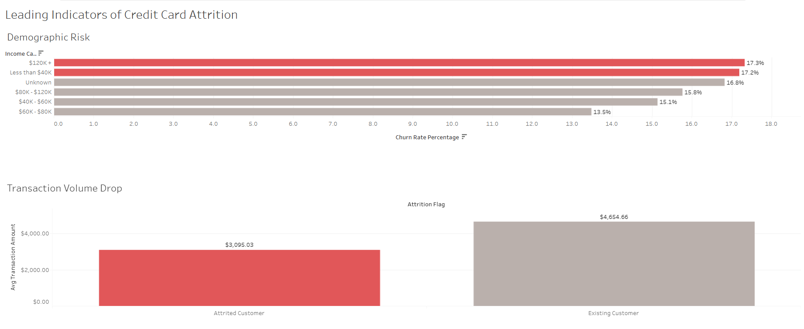

# novabank-credit-card-churn-analysis
Data analytics case study assessing credit card customer churn using SQL and Tableau.
# Credit Card Customer Churn Analysis: NovaBank 💳

## Project Overview
This end-to-end data analytics case study identifies the behavioral and demographic leading indicators of customer churn for a financial institution's credit card product. The goal of this project is to enable the marketing and retention teams to proactively identify at-risk accounts and deploy targeted, cost-effective retention campaigns.

**Tools Used:** Google BigQuery (SQL), Tableau Public, Microsoft Excel  

**Dashboard:** [View the Interactive Tableau Dashboard Here](https://public.tableau.com/views/DataChurnViz/Dashboard1?:language=en-US&:sid=&:redirect=auth&:display_count=n&:origin=viz_share_link)

---

## Phase 1: Ask
**Business Task:** Analyze customer engagement metrics, credit utilization patterns, and demographic profiles to identify the primary behavioral leading indicators of credit card churn.

**Key Stakeholders:** VP of Consumer Credit, Marketing & Retention Teams.

---

## Phase 2 & 3: Prepare and Process
**Data Source:** A public Kaggle dataset containing 10,127 records of customer financial behavior and demographic summaries.

**Data Cleaning (SQL):**
Data was imported into Google BigQuery for cleaning and processing. The cleaning process involved:
* Removing irrelevant machine-learning output columns (`Naive_Bayes_Classifier...`).
* Removing the `CLIENTNUM` identifier to maintain data privacy and anonymization.
* Checking for and filtering out duplicate rows using `DISTINCT`.
* Verifying data types and ensuring zero null values existed in critical financial columns.

*View the SQL cleaning query here: [Link to your 1_data_cleaning.sql file]*

---

## Phase 4: Analyze
I utilized SQL `CASE WHEN` statements and aggregations to compare the financial behavior of existing customers versus attrited (churned) customers. 

**Key Insights Discovered:**
1. **The Demographic Barbell:** Churn is highest at the extreme ends of the income spectrum. The `$120K+` bracket churns at 17.3%, and the `<$40K` bracket churns at 17.2%. The middle-class brackets are highly stable.
2. **Transaction Drop-Off:** Attrited customers showed a stark decrease in card usage before leaving, averaging only $3,095 in total transaction volume compared to $4,655 for retained customers.
3. **Debt Reduction:** Churning customers actively pay down their revolving balances (dropping to an average of $672) prior to account closure, signaling premeditated exit behavior.

---

## Phase 5: Share
I developed an executive dashboard in Tableau to visualize the financial risk and demographic concentration of the churning customer base.

  
*(Note to self: Replace the image path above with the actual path to your uploaded screenshot)*

---

## Phase 6: Act (Business Recommendations)
Based on the analysis, I recommend the following strategic actions to secure at-risk recurring revenue:

1. **Implement an Early-Warning Transaction Trigger:** Set up an automated CRM alert. If a customer's rolling 3-month transaction average drops by more than 25% compared to the baseline ($4,654), automatically deploy a proactive retention email offering a statement credit before they initiate cancellation.
2. **Deploy a Premium Retention Strategy ($120K+ Bracket):** To prevent the loss of significant swipe-fee revenue and high credit limits from the highest earners, offer premium retention perks such as airline lounge access or accelerated reward points, which carry a higher perceived value than a simple fee waiver.
3. **Deploy a Cost-Sensitive Retention Strategy (<$40K Bracket):** Because this segment represents the highest volume of lost accounts, likely due to financial friction, offer a direct $50 statement credit or a temporary 0% APR period to secure the account for another year.
