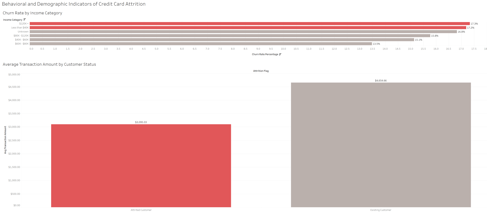

# Behavioral and Demographic Indicators of Credit Card Attrition: NovaBank 💳

## Project Overview
This data analytics case study identifies the behavioral and demographic characteristics associated with historical customer churn for a financial institution's credit card product. The goal of this project is to help marketing and retention teams identify at-risk customer segments and develop targeted retention strategies to protect recurring revenue.

**Tools Used:** Google BigQuery (SQL), Tableau Public, Microsoft Excel  
**Dashboard:** [View the Interactive Tableau Dashboard Here](https://public.tableau.com/app/profile/gregory.faerman/viz/DataChurnViz/Dashboard1#1)

---

## Phase 1: Ask
**Business Task:** Analyze customer engagement metrics, credit utilization patterns, and demographic characteristics to identify the primary behavioral indicators associated with credit card customer churn.

**Key Stakeholders:** VP of Consumer Credit, Marketing & Retention Teams.

---

## Phase 2 & 3: Prepare and Process
**Data Source:** A public Kaggle dataset containing 10,127 records of customer financial behavior and demographic summaries.

**Data Cleaning (SQL):**
Data was imported into Google BigQuery for cleaning and validation. The processing phase included:
* **Customer Uniqueness:** Validated by grouping `CLIENTNUM`. Found 0 duplicate customer IDs, confirming every row represents a distinct customer.
* **Missing Data:** Verified 0 NULL values in critical financial columns. Retained "Unknown" values in demographic fields (Income, Education, Marital Status) to preserve 15% of the dataset's valid financial transaction data.
* **Exclusions:** Removed `CLIENTNUM` to maintain anonymization and dropped external machine-learning output columns.

*View the step-by-step cleaning documentation here: [CHANGELOG.MD](CHANGELOG.MD)*  
*View the SQL cleaning query here: [1_data_cleaning.sql](sql_queries/1_data_cleaning.sql)*

---

## Phase 4: Analyze
I utilized SQL Common Table Expressions (CTEs), `CROSS JOIN` calculations, and `CASE WHEN` statements to compare the financial behavior of existing customers against attrited (churned) customers. 

**Key Insights Discovered:**
1. **The Demographic Barbell:** Churn is highest at the extreme ends of the income spectrum. The `$120K+` bracket churns at 17.3%, and the `<$40K` bracket churns at 17.2%. The middle-income brackets exhibited comparatively lower churn rates.
2. **Transaction Activity Differences:** Attrited customers exhibited significantly lower average transaction activity than existing customers. On average, attrited customers spent 33.51% less in total volume and made 34.64% fewer transactions.
3. **Revolving Balance Variance:** Attrited customers maintained revolving balances that were 46.46% lower than existing customers, suggesting marked differences in borrowing and credit utilization behavior among those who leave the bank.

*View the baseline behavior CTE query here: [2_baseline_behavior.sql](sql_queries/2_baseline_behavior.sql)*  
*View the demographic analysis query here: [3_demographic_churn.sql](sql_queries/3_demographic_churn.sql)*

---

## Phase 5: Share
I developed an executive dashboard in Tableau to visualize the financial risk and demographic concentration of the churning customer base.

  

---

## Phase 6: Act (Business Recommendations)
Based on the observed behavioral differences, I propose the following retention experiments for the marketing team to test:

1. **Implement an Activity Monitoring Strategy:** Because attrited customers show a 34% lower transaction count, the bank should implement a customer activity monitoring strategy that identifies sustained quarter-over-quarter transaction reductions or extended periods of inactivity.
2. **Test Premium Retention Perks ($120K+ Bracket):** The $120K+ income segment exhibited the highest observed churn rate (17.3%), although the difference from the less-than-$40K segment (17.2%) was marginal. Test targeted premium retention perks—such as airline lounge access or accelerated reward points—against a control group to evaluate their effectiveness in improving customer retention and preserving customer value.
3. **Test Cost-Sensitive Retention Offers (<$40K Bracket):** This segment represents the largest number of attrited customers in the dataset. Test targeted offers, such as a $50 statement credit or a temporary 0% APR period, to evaluate whether financial incentives improve customer retention and generate a positive return on investment.

---

## Data Limitations and Analytical Considerations
* **Cross-Sectional vs. Longitudinal:** This dataset contains summarized customer-level metrics rather than chronological transaction records. The analysis identifies associations with historical attrition, but cannot establish whether a specific customer's activity steadily declined immediately before departure. 
* **Causation:** The analysis highlights behavioral correlations, not proven causes of attrition. Proposed retention recommendations have not yet been validated through controlled marketing campaigns.
* **Predictive Limitations:** This analysis  does not develop or validate a predictive churn model. Additional longitudinal data and model validation would be required to build a reliable early-warning system.
